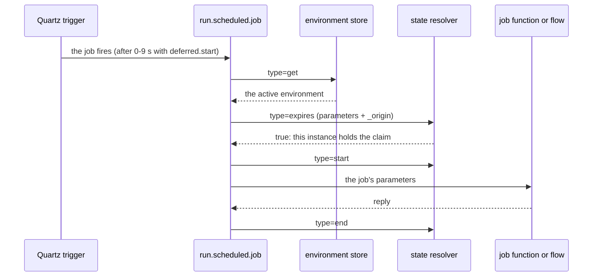

# Mini-Scheduler

*Guide: run functions and flows on a cron schedule - once per firing across a cluster, in the site that is active.*

> **At a glance**
>
> - **What** - the opt-in `mini-scheduler` module runs Quartz cron jobs declared in a `cron.yaml` file. Each job
>   calls a function by its route name or starts an Event Script flow (`flow://`), with the job's parameters as
>   its input.
> - **One run per firing** - every instance of a cluster fires every job. A *state resolver*, a function the
>   application implements, claims each firing in one conditional write to a database the instances share, so
>   exactly one instance runs it.
> - **One active site** - in an active-active deployment, an *environment store* names the active environment and
>   the other site's instances stand by. Operations moves it with one call.
> - **For** developers who schedule work on a cluster, and operators who run, watch and fail over scheduled jobs.

The scheduler keeps no shared state of its own. At each scheduled point it asks two functions that the application
implements against its own database: the environment store (is this site active?) and the state resolver (may this
instance run this firing?). That keeps the module database-neutral, and it puts the job history - who ran what, and
when - in a table or collection that the application already operates.

## Add the module {#add-the-module}

> **Note**: `x.y.z` denotes the current Mercury version shown in the root `pom.xml`.

```xml
<dependency>
    <groupId>org.platformlambda</groupId>
    <artifactId>mini-scheduler</artifactId>
    <version>x.y.z</version>
</dependency>
```

The scheduler starts with the application: it reads the cron file, schedules each job and logs one line per job.
The application provides:

1. **A cron file** that lists the jobs ([Declare the jobs](#cron-yaml)).
2. **A state resolver**, a function that records each run and decides which instance runs a firing. Every job names
   one, including on a single instance ([The state resolver](#state-resolver)).
3. **An environment store**, only for an active-active deployment across sites
   ([Active-active sites](#active-environment)).

The [scheduler example](https://github.com/Accenture/mercury-composable/tree/main/examples/scheduler-example) is a
complete application with file-backed samples of both functions and the admin endpoints that this guide refers to.

## How a job runs {#how-a-job-runs}



1. **Quartz fires the job in every instance** at the time its cron statement names, read in the job's time zone.
2. **With `deferred.start: true`**, each instance waits a random 0 to 9 whole seconds before it goes on
   (`Defer execution of <job> for <n> seconds`).
3. **The active check.** The scheduler reads the active environment from the store. An instance whose environment
   is not the active one skips the job with one line, and the firing ends there.
4. **The claim.** The scheduler asks the state resolver `expires`. `true` runs the job; `false` skips it without a
   log line, because a peer holds the claim. No answer, or an error answer, skips it with a warning.
5. **The run.** The scheduler tells the resolver `start`, then sends the job's parameters to its function, or starts
   its flow.
6. **The end.** When the function returns or the flow ends, the scheduler tells the resolver `end`.

The steps that wait - the active check and the claim - run on one worker, `run.scheduled.job`. Jobs that fire at the
same moment in one instance are therefore prepared one after another. Each preparation normally takes milliseconds,
but a store or a resolver that does not answer holds it for up to 12 seconds ([Slow answers](#retries)). The job
itself runs on its own worker, so a long job does not delay the next one.

## Declare the jobs: cron.yaml {#cron-yaml}

The application property `yaml.cron` lists where to look for the cron file, and the first file found is read:

```properties
yaml.cron=file:/tmp/config/cron.yaml, classpath:/cron.yaml
```

That default lets a deployment mount its own file in `/tmp/config` and fall back to the one packaged in the jar.
Only one file is read, so a mounted file lists every job. When no file is found, the scheduler fails to start with
`Scheduler configuration not found in [...]`.

```yaml
jobs:
  - name: "morning-report"
    description: "09:00 New York time, every day"
    cron: "0 0 9 * * ?"
    timezone: "America/New_York"
    service: "morning.report"
    resolver: "v1.state.resolver"
    parameters:
      region: "east"

  - name: "hourly-cleanup"
    description: "a flow, at a quarter past every hour"
    cron: "0 15 * * * ?"
    service: "flow://cleanup-flow"
    resolver: "v1.state.resolver"

deferred.start: true
leader.election: false
```

| Key | Required | Meaning |
|-----|----------|---------|
| `name` | yes | The job's unique reference, and the key of its record in the state resolver's database. Letters, digits, `.`, `_` and `-`; it neither starts nor ends with `.`, `_` or `-`, and holds no `..`. |
| `cron` | yes | A Quartz cron statement ([Cron statements](#cron-statements)). |
| `service` | yes | The route name of the function to call, or `flow://<flow-id>` to start an Event Script flow. |
| `resolver` | yes | The route name of the state resolver, normally `v1.state.resolver`. |
| `timezone` | no | The region whose clock the statement is read in, e.g. `America/New_York` ([Time zone](#time-zone)). |
| `parameters` | no | A map sent to the job as its input. A key that starts with `_` is reserved for the system. |
| `description` | no | For people; the scheduler does not read it. |

Two keys belong to the file itself, not to a job: `deferred.start` (default `false`) and `leader.election` (default
`false`, see [Leader election](#leader-election)).

The startup log lists each job it loaded:

```text
Scheduled job: morning-report, service: morning.report, statement: 0 0 9 * * ?, time zone: America/New_York
```

An entry that is missing a required key, or names a malformed job or route name, is skipped with
`Invalid job entry#<n> - check name, schedule and service`, and the other jobs load. An unknown time zone skips the
entry the same way, naming the zone. A parameter whose key starts with `_` is dropped with a warning, and the job
keeps its other parameters.

**How often a job may run.** With `deferred.start`, keep a job's period above 10 seconds, the deferral's range. With
more than one instance, the period must also exceed the state resolver's window plus 9 seconds
([The claim](#conditional-claim)): with the worked examples' 30-second window, run a job at most once a minute.

### Cron statements {#cron-statements}

A Quartz cron statement has six or seven fields separated by spaces:

```text
Seconds  Minutes  Hours  Day-of-month  Month  Day-of-week  [Year]
 0-59     0-59    0-23     1-31       1-12 or   1-7 or     optional
                                      JAN-DEC   SUN-SAT
```

| Character | Meaning | Example |
|-----------|---------|---------|
| `*` | every value of the field | `*` in Minutes: every minute |
| `?` | no specific value, in Day-of-month or Day-of-week (one of the two takes it) | `0 0 9 * * ?` |
| `-` | a range | `10-12` in Hours: 10, 11 and 12 |
| `,` | a list | `MON,WED,FRI` in Day-of-week |
| `/` | an increment | `0/15` in Minutes: every 15 minutes from minute 0 |
| `L` | the last day of the month, or the last given weekday of the month | `6L` in Day-of-week: the last Friday |
| `W` | the weekday nearest to a day of the month | `15W` |
| `#` | the nth given weekday of the month | `6#3`: the third Friday |

| Statement | Fires |
|-----------|-------|
| `0 0 12 * * ?` | at noon every day |
| `0 15 10 ? * MON-FRI` | at 10:15, Monday to Friday |
| `0 0/5 14 * * ?` | every 5 minutes from 14:00 to 14:55, every day |
| `0 15 10 L * ?` | at 10:15 on the last day of every month |

## The job's function or flow {#the-job}

A **function** receives the job's parameters as its body and the job's name in the header `job`:

```java
@PreLoad(route = "morning.report")
public class MorningReport implements TypedLambdaFunction<Map<String, Object>, Void> {
    @Override
    public Void handleEvent(Map<String, String> headers, Map<String, Object> input, int instance) {
        var job = headers.get("job");          // "morning-report"
        var region = input.get("region");      // "east"
        // ... the work ...
        return null;
    }
}
```

A **flow** receives the parameters as `input.body` and the job's name as `input.header.job`, so its tasks map them
like any other input:

```yaml
flow:
  id: 'cleanup-flow'
  description: 'the hourly cleanup'
  ttl: 60s

first.task: 'cleanup.task'

tasks:
  - input:
      - 'input.body -> *'
      - 'input.header.job -> header.job'
    process: 'cleanup.task'
    output: []
    description: 'the scheduled work'
    execution: end
```

What the function returns, or the flow answers, is not used. Returning ends the run: the scheduler then tells the
state resolver `end`, so the resolver's record shows when the job finished. The job never sees a parameter whose key
starts with `_`; those keys belong to the scheduler's requests to the resolver.

## Time zone {#time-zone}

A cron statement is read in the JVM's default time zone, which is UTC in most containers. UTC has no daylight saving,
so a job whose hour belongs to a region moves by one hour against the local clock twice a year. Give the job a
`timezone` and Quartz reads its statement in that zone:

```yaml
  - name: "morning-report"
    cron: "0 0 9 * * ?"
    timezone: "America/New_York"
```

The job then runs at 09:00 New York time on both sides of a changeover: 13:00 UTC under daylight saving time and
14:00 UTC under standard time.

- **Name a region**, such as `America/New_York`, not an abbreviation such as `EST`. A fixed offset such as `UTC` or
  `-05:00` never follows daylight saving.
- **An unknown id is rejected**: `America/NewYork` skips the job with an error at startup rather than run it on GMT.
  The startup log names each job's time zone, so a check after a deployment is one look.
- **On a changeover day**, a job set in the hour the clocks skip does not run (02:30 New York time on the second
  Sunday of March), and a job set in the hour they repeat runs once (01:30 on the first Sunday of November).
- **The resolver's `schedule`** carries the statement followed by ` @` and the zone, `0 0 9 * * ? @America/New_York`,
  for information. A job without a zone sends the statement alone. The suffix adds up to 34 characters to the column
  that stores it.

A job without the key keeps the JVM's time zone.

## One run per firing: the state resolver {#state-resolver}

Every instance fires every job, and the state resolver decides which instance runs it. It is a function at the route
the job names in `resolver`, normally `v1.state.resolver`.

### The contract {#resolver-contract}

| `type` header | Other headers | Body | Answer |
|---------------|---------------|------|--------|
| `expires` | `name` (the job) | the job's parameters, plus `_origin` | `true` to run this firing, `false` to skip it |
| `start` | `name`, `service`, `schedule` | the job's parameters, plus `_origin` | `true` |
| `end` | `name` | none | `true` |

`_origin` is the asking instance's origin id. It stays the same while the instance runs, and the instance logs it at
startup:

```text
Scheduler instance 20261104f478264b6c1244f0889fa423e4ceef4e - the state resolver receives it as _origin
```

A resolver that stores the parameters stores `_origin` with them, so a state record names the instance that wrote it.
A dashboard that shows the parameters filters out the keys that start with `_`, as the example's
`GET /api/schedule/{name}` does.

On a **single instance**, the resolver only records the runs and answers `true` while the previous run has expired,
which the example's `StateResolver` does with a local file. On **more than one instance**, `expires` claims the job.

### Claim the job in one conditional write {#conditional-claim}

`expires` claims the job for the instance that asks, in one conditional write to a database the instances share. The
write succeeds when no instance has claimed the job within the resolver's window, or when the asking instance holds
the claim already, and the database refuses it otherwise. Exactly one instance gets `true`, however close together the
instances ask, and the others are answered at once. The claim needs three things.

**1. One conditional write.** The other shapes fail, and a lab of two instances showed how:

- *Read the record, then write it.* Two instances that ask within moments of each other both read "expired" and both
  run the job: in 10 of 11 firings when they fired at the same instant, and in 12 of 240 with `deferred.start`, which
  puts two instances in the same second 1 time in 10.
- *Write, wait, then read the record back.* It holds only while every write lands within the wait. A pause longer
  than the wait between one instance's read and its write - a garbage collection, a throttled container, a slow
  primary - runs the job on both, and neither can tell.
- *A record lock held while the resolver answers.* It picks one instance, but the other waits on the lock, and the
  scheduler reports the wait as a timeout.

**2. A unique key on the job's name.** When the condition fails, the write becomes an insert, and the database must
refuse a second record for the same name. Use the name as the primary key in PostgreSQL, or as the `_id` in MongoDB. A
separate name field needs a *unique* index, `createIndex({name: 1}, {unique: true})` in MongoDB: with a plain index,
or none, both instances insert a record and both run the job. Being ACID does not pick one winner by itself: an
upsert without its condition succeeds for every instance.

**3. A window** that covers the questions about one firing and no more:

- **Longer than 18 seconds plus the database's latency.** A peer may ask up to 9 seconds after the claim
  (`deferred.start`) and ask again up to 9 seconds after that ([Slow answers](#retries)). The worked examples use 30
  seconds.
- **Shorter than the job's period minus 9 seconds**, because the previous run may have been claimed 9 seconds into
  its period. For a daily job in a region with daylight saving, the period is 23 hours on the day the clocks go
  forward, so a window of 24 hours would refuse that day's run.

`deferred.start` does not pick one instance; the claim does. The deferral only spreads the instances' questions over
9 seconds.

The two worked examples below were each run with eight instances claiming the same job at the same instant, 300 times
on a first run and 300 times after an expired run: exactly one instance won every time, on PostgreSQL 18.4 and on
MongoDB 8.0. The resolver's `handleEvent` dispatches on the `type` header: `expires` returns `claim(name, input)`, and
`start` and `end` run the writes that follow the claim.

### Worked example: PostgreSQL {#worked-example-postgresql}

The job's name is the primary key, and the parameters, with `_origin` among them, are a JSONB column:

```sql
CREATE TABLE job_state (
    name       TEXT PRIMARY KEY,
    service    TEXT,
    schedule   TEXT,
    parameters JSONB,
    start_time TIMESTAMPTZ NOT NULL,
    end_time   TIMESTAMPTZ
)
```

`expires` claims the job in one statement. It inserts the job's record, or, when the record exists, updates it only if
the window has passed or the asking instance holds the claim:

```java
private static final String CLAIM = """
        INSERT INTO job_state (name, parameters, start_time) VALUES (?, ?::jsonb, now())
        ON CONFLICT (name) DO UPDATE
            SET parameters = EXCLUDED.parameters, start_time = EXCLUDED.start_time, end_time = NULL
            WHERE job_state.start_time < now() - interval '30 seconds'
               OR job_state.parameters ->> '_origin' = EXCLUDED.parameters ->> '_origin'""";

/** "expires": claim the job for the instance that "_origin" names. */
private boolean claim(String name, Map<String, Object> parameters) throws SQLException {
    var json = SimpleMapper.getInstance().getMapper().writeValueAsString(parameters);
    try (var db = dataSource.getConnection(); var sql = db.prepareStatement(CLAIM)) {
        sql.setString(1, name);
        sql.setString(2, json);
        // one row: this instance holds the claim; none: a peer claimed the job within the window
        return sql.executeUpdate() == 1;
    }
}
```

`now()` is the database's clock, so the instances' clocks do not enter into it. `start` and `end` record the run:

```sql
-- start: the run that the claim allowed, or an operator's manual run
INSERT INTO job_state (name, service, schedule, parameters, start_time) VALUES (?, ?, ?, ?::jsonb, now())
ON CONFLICT (name) DO UPDATE
    SET service = EXCLUDED.service, schedule = EXCLUDED.schedule, parameters = EXCLUDED.parameters,
        start_time = EXCLUDED.start_time, end_time = NULL;
-- end
UPDATE job_state SET end_time = now() WHERE name = ?;
```

### Worked example: MongoDB {#worked-example-mongodb}

The job's name is the document's `_id`, which MongoDB always indexes uniquely, and the parameters, with `_origin`
among them, are a sub-document:

```java
private static final long WINDOW = 30_000;
// MAJORITY: a failover of the primary cannot lose a claim it acknowledged
private final MongoCollection<Document> states = client.getDatabase("scheduler").getCollection("job_state")
        .withWriteConcern(WriteConcern.MAJORITY);

/** "expires": claim the job for the instance that "_origin" names. */
private boolean claim(String name, Map<String, Object> parameters) {
    var now = new Date();
    var filter = Filters.and(Filters.eq("_id", name), Filters.or(
            Filters.lt("start", new Date(now.getTime() - WINDOW)),
            Filters.eq("parameters._origin", parameters.get("_origin"))));
    var update = Updates.combine(Updates.set("parameters", new Document(parameters)),
            Updates.set("start", now), Updates.unset("end"));
    try {
        states.updateOne(filter, update, new UpdateOptions().upsert(true));
        return true;
    } catch (MongoWriteException e) {
        if (e.getError().getCategory() == ErrorCategory.DUPLICATE_KEY) {
            // the filter missed, so the upsert's insert met the peer's document for this job
            return false;
        }
        throw e;
    }
}
```

The filter matches when the window has passed or the asking instance holds the claim. When it does not, the upsert
inserts a document with the job's name as its `_id`, which the peer's document already has, and MongoDB refuses it.
The answer to the write is the decision, so nothing is read back. The window is measured on the instance's clock,
which differs from its peers' by far less than 30 seconds. `start` and `end` record the run:

```java
// start: the run that the claim allowed, or an operator's manual run
states.updateOne(Filters.eq("_id", name), Updates.combine(Updates.set("service", service),
        Updates.set("schedule", schedule), Updates.set("parameters", new Document(parameters)),
        Updates.set("start", new Date()), Updates.unset("end")), new UpdateOptions().upsert(true));
// end
states.updateOne(Filters.eq("_id", name), Updates.set("end", new Date()));
```

### Slow answers: retries {#retries}

The scheduler waits 3 seconds for the environment store and for the state resolver's `expires`. A question that is
not answered in time is asked again, up to 3 times, so a function that is slow at a cold start is retried instead of
failing the job. Each timed-out attempt is a warning, and an answer after a retry says so:

```text
WARN  State resolver v1.state.resolver for job morning-report - attempt 1 of 4 timed out after 3000 ms, retrying
INFO  State resolver v1.state.resolver for job morning-report answered at attempt 2 of 4
```

When no attempt is answered, the job is skipped for that firing, with an error and a warning naming it. An error
answer is not retried.

A timed-out question is not cancelled: the resolver still works on it, and only its answer is discarded. So the
claim that a timed-out attempt made belongs to the instance that asks again, and the retry carries the same `_origin`.
The resolver answers `true` again to the instance that holds the claim - the `OR` condition on `_origin` in both worked
examples. Without it, the retry finds the claim, answers "not expired", and nobody runs the job. When "not expired"
follows a timed-out attempt, the scheduler logs a warning; on an instance that lost the claim to a peer, that warning
is expected.

### Leader election instead {#leader-election}

For backward compatibility, `leader.election: true` picks the instance by a service mesh instead of the state
resolver: the application connects to the mesh (`cloud.connector=kafka`, see the
[Minimalist Service Mesh](service-mesh.md)), and the instance with the lowest origin id among the schedulers it finds
runs every job. The resolver is not asked `expires`, but it still receives `start` and `end`. The mesh is an opt-in
for applications that need it for other reasons; the claim needs only the database the resolver already writes to.
Quartz's own cluster mode, configured against a database, is a third way.

## Active-active sites: the active environment {#active-environment}

A scheduler deployed in two sites, Production and DR, active-active fires every job in both, and a job that publishes
to its site's Kafka cluster wakes the DR applications that must stay idle while Production is up. One property names
the instance's environment:

```properties
scheduler.environment.name=${ENV_NAME:prod}
```

The name is one word of letters, digits, `-` and `_`. The instance is **active** when its environment is the *active
environment*, compared without regard to case, and on **standby** otherwise:

```text
Standby: job morning-report skipped - the active environment is prod, this instance is DR
```

Both names default to `prod`, so an installation that sets neither runs every job as before.

**The active environment lives in a data store**, not in a property, because Kubernetes restarts a pod without
notice. The store is a function the application implements against its own database, at the route
`scheduler.environment.store` names (default `v1.environment.store`):

| `type` header | Other headers | Answer |
|---------------|---------------|--------|
| `get` | none | the persisted name as text, or nothing when none was set yet |
| `set` | `environment` (the name), `operator` (who asked) | `true` once the name is persisted |

The scheduler reads the store at every scheduled point, before a job runs, so one call moves every instance of every
site at its next job. A store that fails to answer leaves the last value it read, with a warning. Until an operator
sets a value, the active environment is `prod`. The startup log names both environments and the store:

```text
Scheduler environment DR - active environment prod (persisted by v1.environment.store) - this instance is on standby
```

Without a registered store, the value lives in memory only, a restart resets it to `prod`, and that startup line is a
warning that says so.

**Moving the active environment.** The application exposes an endpoint that calls
`ActiveEnvironment.getInstance().activate(name, operator)`. The example's endpoint is
`GET`/`POST /api/scheduler/environment`; the operations team calls it around a Production maintenance window, to `DR`
before and back to `prod` after:

```json
{"active": "DR", "operator": "jane.doe"}
```

The answer is the instance's status - `environment`, `active`, `mode` (`active` or `standby`), `persistent` and
`store`. The name is persisted first, so a refusal by the store fails the call and changes nothing. Before 4.12.26
the instance's name was the key `scheduler.environment`, which is still read, with a warning, when it holds a plain
value. The decision is recorded as [ADR-0030](../arch-decisions/ADR.md).

## Operate {#operate}

### Run a job manually {#manual-run}

An event to `run.scheduled.job` with the headers `job` (the job's name) and `operator` (who asked) runs the job at
once. The example exposes it as `POST /api/schedule/{name}` with `{"operator": "jane.doe"}`:

```text
Operator jane.doe runs morning-report manually
```

A manual run skips the claim, and it runs on a standby instance too, with a log line that says so. The resolver still
records `start` and `end`, so with the worked examples a manual run also refuses the peers' claims for the next 30
seconds. Use it in a test environment, or to repeat a job deliberately.

### Watch the jobs {#watch}

The state resolver's records are the job history: when each job last started and ended, with which parameters, and
which instance (`_origin`) ran it. The example reads them back as `GET /api/schedule` (every job) and
`GET /api/schedule/{name}` (one job, its `_` keys filtered out). The scheduler's own log lines:

| Log line | Meaning |
|----------|---------|
| `Scheduled job: <job>, service: ..., statement: ..., time zone: ...` | the job is loaded, at startup |
| `Invalid job entry#<n> - check name, schedule and service` | the entry is skipped; see the table in [Declare the jobs](#cron-yaml) |
| `Job <job> parameter <key> ignored - a key that starts with '_' is reserved for the system` | rename the parameter |
| `Scheduler instance <origin> - the state resolver receives it as _origin` | the id that this instance's state records carry |
| `Scheduler environment <name> - active environment <name> ... - this instance is active` | the active check at startup; a warning when the value is in memory only |
| `Defer execution of <job> for <n> seconds` | `deferred.start` at work |
| `Standby: job <job> skipped - the active environment is ..., this instance is ...` | this site is on standby |
| `State resolver <route> for job <job> - attempt <n> of 4 timed out after 3000 ms, retrying` | a slow resolver, asked again; `Environment store <route> - attempt ...` for the store |
| `Job <job> skipped for this firing - state resolver <route> did not answer` | four attempts timed out; the firing is lost |
| `Job <job> skipped - state resolver <route> answered status <status>, ...` | the resolver failed; fix its error |
| `Job <job> skipped - state resolver <route> answered not expired after an attempt had timed out: ...` | expected on the instance that lost the claim; when every instance logs it for the same firing, the resolver does not answer `true` to its own `_origin` |
| `Resolver service <route> does not exist` | the job's `resolver` is not registered in this application |
| `Scheduled service <route> does not exist` | the job's function is not registered; the resolver recorded a `start` with no `end` |
| `Operator <who> runs <job> manually` | a manual run |
| `Active environment set to <name> by <who> - this instance (<name>) is active` | an operator moved the active environment |

### Troubleshooting {#troubleshooting}

| Symptom | Cause |
|---------|-------|
| A job runs on two instances | The resolver reads its record and then writes it, or the job's name has no unique key, or the window is shorter than a peer's last question ([The claim](#conditional-claim)). |
| A job never runs | No instance is active ([Active-active sites](#active-environment)); or the window is longer than the job's period minus 9 seconds, so every firing finds the previous claim; or the entry was skipped at startup. |
| A job runs at the wrong hour after a changeover | It has no `timezone`, or names an abbreviation or a fixed offset ([Time zone](#time-zone)). |
| Timeouts in the log | The resolver or the store is slow; a cold start passes with a retry. A resolver that waits on a lock while it answers times out whenever two instances ask together. |
| A record has a `start` and no `end` | The job's function is not registered, or it has not replied yet. |

## Configuration {#configuration}

| Setting | Where | Default | Purpose |
|---------|-------|---------|---------|
| `yaml.cron` | application properties | `file:/tmp/config/cron.yaml, classpath:/cron.yaml` | where the cron file is found |
| `deferred.start` | the cron file | `false` | a random 0-9 s delay per job per instance |
| `leader.election` | the cron file | `false` | pick the instance by a service mesh instead of the claim |
| `jobs[].timezone` | the cron file | the JVM's time zone | the region a job's statement is read in |
| `scheduler.environment.name` | application properties | `prod` | this instance's environment |
| `scheduler.environment.store` | application properties | `v1.environment.store` | the route of the environment store |

Each is described in the [Configuration Reference](configuration-reference.md#scheduler).

## See also

- [Configuration Reference: Scheduler](configuration-reference.md#scheduler) - every setting, with its default.
- [The scheduler example](https://github.com/Accenture/mercury-composable/tree/main/examples/scheduler-example) - a
  runnable application with sample resolver, store and admin endpoints.
- [Event Script](event-script/index.md) - the flows a job can start with `flow://`.
- [Minimalist Service Mesh](service-mesh.md) - the mesh that `leader.election` relies on.
- [Architectural Decision Records](../arch-decisions/ADR.md) - ADR-0030, the active environment.
