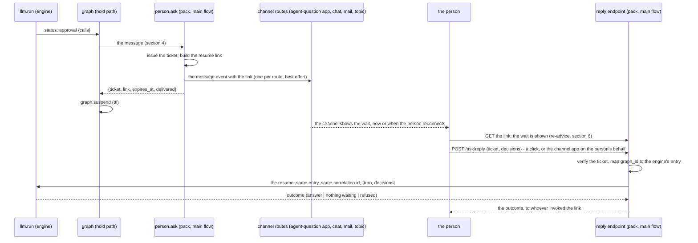

# Ask a person — an agent's question or approval delivered to a person over an occasionally connected channel, answered through a return link that resumes the graph — design spec

**Status:** DRAFT, round 4 (2026-11-20, Claude Code for Eric); steps 1-5 of the build plan were built and driven on
2026-11-19 (sections 18 to 20). Round 4 records Eric's sprint of 2026-11-20 - the question record as part of the
transcript audit log, the React UI as the one front-end, static content in the pack hosts, identity by OAuth 2.0 alone
(sections 13 and 21). Raised as RFC-0014 in
[`docs/arch-decisions/RFC.md`](../docs/arch-decisions/RFC.md). Round 1 was written the same day from Eric's concept and
the review that followed; Eric's review of round 1, one further generalization, is recorded in section 13 and applied
throughout: the paper is now two parts — **the main flow** (suspend, send a message with the resume link, accept the
link's invocation, resume the graph), which knows no channel's internals, and **delivery and collection**, where the
agent-question app is one store-and-forward channel beside chat, mail and a topic. Round 3 records Eric's rulings on
round 2 — every question agreed — and the `advice` kind (section 13); the defaults set without a ruling are in
section 15.
**Serves:** `bp-agent-orchestration` → `vision-mercury-composable` (Track 2, the graph as AI SDLC).
**Extends:** [`llm-helper-agent-loop.md`](./llm-helper-agent-loop.md) section 7 — 7.1 (a tool call that must wait) and
7.3 (a question for a person, the ask row), both built in both engines — and the published
[Workflow Suspension](../docs/guides/knowledge-graph/workflow-suspension.md) guide; it answers the concept's experiment
E1 (human authority) in [`ai-agent-orchestration.md`](./ai-agent-orchestration.md) section 7 with a channel to the
person.
**ADR-0033, ADR-0035 and ADR-0036 stand:** the loop maps names to routes and holds a waiting call in its approval block;
the transcript and its audit stay on the pack's side; a tool is built or bound by rule. This paper adds the delivery of
a waiting call to a person and the collection of the answer. It moves no waiting into the pack: the engine waits, as it
does today.
**Repo scope:** the packs (mercury-python first, mercury-nodejs in lockstep): the main flow's extension — the function
`person.ask`, the ticket, the resume link and its reply endpoint — and, as a separate standalone application on the pack
framework, the agent-question app - since round 4 the backend of the React UI, reading the question record the main
flow keeps in the audit database - and, in the Node pack only, the UI itself; a route hook and a static content service
in the host. Here: the Playground's
reference graph (the `advise` checkpoint calls the function; the resume node gains a gate), a second Playground graph on
the ask row, and the guide pages. The engines' loop: no change in version 1.

---

# Part I — The main flow

## 1. The problem

The loop can wait. A row marked `write: true` holds the turn for a person under the default mode, and a row marked
`ask: true` lets the model put a question to a person and carry on in the same conversation with the answer (sections
7.1 and 7.3 of the loop spec, built in Java's `AgentLoop` and Rust's `agent_loop.rs`). The graph suspends durably:
`graph.suspend` writes the record to the state store under the graph and the business correlation id, with a mandatory
time to live, and a later request on the same entry with the same correlation id resumes the run on any instance,
at most once. The Playground's `order-assistant` is the reference: `approval` goes to the `advise` checkpoint, which
stages the waiting calls with their arguments and suspends; a request carrying `turn` and one decision per waiting call
resets the loop node and runs it again.

What is missing is the person. Nothing carries the waiting calls to anyone, and nothing brings a decision back except
a request a developer types. The Playground's console is the only surface on which a wait is visible, and it is a
developer's tool. The person who must decide uses a phone or a laptop that is not always connected: approvals and
questions arrive while the device is off, several may be open when it reconnects, and an answer may come after the
suspension has expired. The ask row itself is documented only in the loop spec, not in a guide.

Eric's statement of the flow (2026-11-19):

1. Send a message, a request for the person's response, and suspend the workflow graph.
2. If the person is online, the person responds.
3. If not, the messages are buffered for store-and-forward until the person reconnects; with more than one waiting,
   the person selects which to answer. The response is a click on a return link, a URL, that resumes the graph. The
   UI is one channel among several, following the same design, and it can automate the click.

And his generalization on round 1: the agent-question UI is encapsulated as a store-and-forward messaging system just
like a chat, a mail server or a topic — a standalone application on the pack framework with a streaming HTTP server
for the browser and PostgreSQL as its inbox buffer — and the tool does not know it exists: it sends a message with the
resume link. The main flow is suspend, send the link, accept the link's invocation, resume.

## 2. Principles

- **P1 — The engine waits; the pack delivers and collects.** A tool call is bounded by the tool timeout and the Event
  API's time to live, seconds to a minute; a person takes minutes to days. A wait inside the pack would die with a
  restart and duplicate what `graph.suspend` already does well. The ask row stays routeless and the approval block
  unchanged; the new function sends the wait out and the reply endpoint forwards the decision in.
- **P2 — The tool sends an event and knows no channel.** `person.ask` publishes one message, with the resume link, to
  the routes the installation configures. What a route does with it — show it in a browser, post it to a chat, send a
  mail, publish it to a topic — is that channel's business, and its buffering is its own.
- **P3 — Every channel is a store-and-forward system.** A chat keeps its messages, a mail server its mailboxes, a
  topic its log; the agent-question app keeps an inbox in PostgreSQL. The main flow keeps no store at all, so the
  ticket must stand on its own (section 5).
- **P4 — One reply path: the resume link.** Every channel delivers the same message with the same link, and every
  answer — a person's click or a channel app's automated invocation — arrives through the same reply endpoint.
- **P5 — The link opens; a deliberate action resumes.** Chat clients, mail scanners and link unfurlers fetch URLs to
  build previews. A GET shows the wait; only a submit resumes (section 6).
- **P6 — A reply never starts a fresh run.** A resume is an ordinary request on the graph's entry, so a request that
  finds no suspended record would run the graph from the start. The reference graph's resume node refuses a decision
  that finds nothing waiting, and the reply endpoint answers such a ticket as expired or already decided (section 7).
- **P7 — A route names the capability, never the transport.** The graph calls `person.ask`; which channels carry the
  message is the installation's configuration, certified with the deployment (ADR-0036's rule, applied to a person).
- **P8 — Nothing personal in a URL; who decided is recorded.** A link carries an opaque ticket; a decision reaches the
  audit store with the operator's identity and the time in the decision's note.

## 3. The flow



Steps 1 to 3 of section 1 are all here: step 1 is the first six arrows; steps 2 and 3 differ only in when the channel
shows the wait, and the reply path is the same. A reply after the expiry takes the same path and ends in
`nothing waiting`. The main flow never learns whether the person was online.

An **advice** is the same first arrows without the ticket, the link or the suspend (R8): the graph calls `person.ask`
from any node — after a resume, to acknowledge the decision; at a milestone of a long run; at the end, with the outcome
— and the channels show it. The person learns whether to wait for the next question or to come back later.

## 4. The message

`person.ask` is a composable function of the pack, called by the graph's hold node with `graph.task`. Its input is the
message, composed by the node's input mapping from the loop's outcome and the graph's own knowledge of itself. It
carries the metadata Eric asked for — the graph id, a description and the correlation id — and what the reply needs:

```json
{
  "kind": "approval",
  "graph_id": "order-assistant",
  "description": "Customer-support assistant: a refund waits for a supervisor",
  "correlation_id": "order-1002-case",
  "turn": 2,
  "node": "assist",
  "summary": "issue_refund for ORD-1002, 174.00 USD: 'Shipment lost in transit'",
  "calls": [
    {"id": "toolu_01...", "name": "issue_refund", "route": "demo.refund.issue", "wait": true,
     "input": {"order_id": "ORD-1002", "amount": 174.0, "reason": "Shipment lost in transit"}}
  ],
  "ttl": "2d",
  "requested_at": "2026-11-19T09:12:04.118Z"
}
```

- `kind` is `approval` (calls marked `write: true` or held under `manual`), `question` (an ask row: the call carries
  `ask: true`, no route, and its `input` is the question and its options as the model shaped them) or `advice` (R8: a
  notification with no decision — a status update of a long-running run, an acknowledgement after the person's
  response so the next steps can be anticipated, the outcome at the end). A turn can hold approvals and questions
  together; the kind is `approval` when any call needs `approved`, and each call is rendered by its own shape. An
  advice carries `summary` and an optional `details` text, no `calls` and no `ttl`.
- `graph_id`, `description` and `node` are the graph's: the id it is deployed under, a one-line description of the use
  case written on the hold node, and the loop node that waits. The function cross-checks `graph_id` against the
  graph-context header `x-graph-id` when the engine supplies one (the audit store spec's section 8, ADR-0035).
- `correlation_id` and `turn` address the resume. `summary` is the one line a chat message or a mail subject shows,
  written by the hold node's mapping; a channel that can show more shows the calls themselves.
- `calls` is the approval block as the loop returned it, unchanged: a person cannot approve what they cannot see.
  Absent for an advice, as is `ttl`.
- `ttl` is the suspend node's own time to live, passed by the same mapping, so the `expires_at` the function computes
  equals the suspension's expiry.

An advice, after the decision above was accepted:

```json
{
  "kind": "advice",
  "graph_id": "order-assistant",
  "description": "Customer-support assistant: a refund waits for a supervisor",
  "correlation_id": "order-1002-case",
  "turn": 3,
  "node": "acknowledge",
  "summary": "Your decision was received; the assistant is issuing the refund",
  "details": "The next question, if any, is expected within two minutes.",
  "requested_at": "2026-11-19T09:40:12.004Z"
}
```

**The message event.** For a wait, the function adds `ticket`, `link` and `expires_at`; for an advice it adds nothing,
since there is nothing to resume. It sends the whole message as one event to each configured channel route
(`ask.channels`, section 8), a request with a short timeout so the delivery is known, and returns `{ticket, link,
expires_at, delivered: [{route, ok}]}` to the graph — `delivered` alone for an advice. A channel that fails is logged by
type, never by content, and never fails the hold: the graph may put the link into its own response to the caller and
may route on an empty `delivered` list to say so.

## 5. The ticket

The ticket is the message's address, in a form that stands on its own because the main flow keeps no store and a
channel keeps only what it chooses to keep (P3):

```text
ticket  = "v1." + base64url(payload) + "." + base64url(HMAC-SHA256(key, payload))
payload = {"g": graph_id, "c": correlation_id, "t": turn, "k": kind, "e": expires_at_epoch_seconds}
```

- **Opaque and clean.** No question text, no business data, no person: a ticket in a chat log or a proxy log reveals a
  graph id and a correlation id to whoever already holds the key, and nothing to anyone else.
- **Stateless.** The reply endpoint verifies a ticket with the key alone and knows what to resume without a lookup. The
  key is `ask.ticket.key`, an `${ASK_TICKET_KEY}` reference resolved from the pack's environment, never logged;
  `ask.ticket.previous-key` lets a rotation verify the tickets already in flight.
- **Single use is the engine's.** A ticket is accepted as many times as it is presented; the engine's at-most-once
  resume decides, and the second presentation gets `nothing waiting`. The main flow adds no counter it would have to
  share between replicas; a channel app that wants to show "decided by X" keeps that in its own buffer (section 10).
- **Expiry is the suspension's.** `e` is the computed `expires_at`. An expired ticket is refused by the reply endpoint
  without a call to the engine; a ticket inside its window whose record has gone — a resume by another path — gets the
  gate's `nothing waiting`.
- A re-advice for the same turn (section 7) issues a new ticket; an older ticket still verifies until its own expiry
  and leads to the same wait, so a stale link in a chat still works.

## 6. The resume link and the reply endpoint

The link is `<ask.reply.url>/ask/<ticket>`, served by the main flow's extension in the pack. It targets the pack, never
the engine: the engine's resume wants a body on the graph's entry, and the engine stays internal to the installation.

- **GET shows and never resumes (P5).** The page renders the wait: the kind and the graph from the ticket, and the
  current waiting calls from the engine by the reference graph's re-advice convention — a request with the turn and no
  decisions on the same entry and correlation id, which returns the waiting calls and suspends again (section 7: the
  re-suspend renews the wait, and a dead wait answers `nothing-waiting`, so the page says it has expired). The page then offers the decision form: approve or refuse with a note per
  waiting call, or an answer for a question. Nothing is read from any store: the question record of round 4 (section 21) is an audit log, written and never
  consulted to render a wait - the engine holds the truth of what waits.
- **POST resumes.** `POST /ask/reply` with `{ticket, decisions, decided_by?}`. A person's browser posts the page's
  form; a channel app posts the same shape on the person's behalf, which is how the agent-question app automates the
  click (section 10). The endpoint verifies the ticket, maps `graph_id` to the engine's entry through
  `ask.graphs.<graph_id>.entry` — an allowlist in configuration, so the pack never posts to an address a message told
  it — and sends the resume as the Playground documents it: the same entry, the correlation id in `x-correlation-id`,
  `{turn, decisions}` in the body. The decisions are the person's and nothing else: `{id, approved, note}` for a tool
  call, `{id, answer}` for a question, the shapes the loop accepts. The operator's identity — the signed-in person on a
  browser's request (none in development, an OAuth 2.0 access token in production - section 8; round 4 removed
  `proxy`), or `decided_by` on a channel app's request made under the app's own credential — and the time are prefixed
  to each note; the audit store carries it when the note reaches the model, which the loop does for a refused call
  (section 20 narrows this: an approved call's note goes nowhere the audit sees; since round 4 the answer itself - the
  decisions, who decided, when, the engine's outcome - is in the question record, section 21, so every decision is on
  record whether or not a note reaches the model).
- **The outcome goes back to the invoker.** The engine's reply — an `answer`, a new `approval` (the model asked again),
  a `nothing waiting` from the gate (410), a refusal of the decisions (400, an unknown id or a call decided twice,
  turned into an advice by the reference graph) — is returned as the response of the POST, so a page shows it and a
  channel app shows it to its device. Round 4 (section 21): the main flow writes the answer - the decisions, who
  decided, when, the engine's outcome - to the question record it keeps in the audit database, beside the engine's
  transcript audit store, which holds the turn with the note (ADR-0035); a channel keeps no record of its own.

## 7. The reference graphs (the Playground)

- **`order-assistant`, the approval shape.** The `advise` checkpoint gains one call before it suspends: `person.ask`
  with the message of section 4, mapped from the loop's `approval` block, the node's constants (`graph_id`,
  `description`, `ttl`) and the correlation id; the advice returned to the caller carries the link. The `decide`
  node's gate is extended by one rule (P6): a request that carries `decisions`, or a `turn`, while `model.run` is
  `fresh` — nothing was waiting, the record expired or was resumed already — answers `{"type": "nothing-waiting"}` with
  HTTP 410 and never starts a conversation (the `turn` probe was added after the live drive of step 5: the reply page's
  GET re-advises a dead wait with the ticket's turn and no decisions, and it must show as expired, not as the engine's
  input check). On a live record, a request without decisions still re-advises and suspends again; a request for
  another turn still re-advises.
- **The re-suspend renews the wait (verified in step 2).** `graph.suspend` takes its `ttl` as written on the node - the
  compiler validates the literal - so a re-advice suspends again for a fresh period. A ticket keeps the expiry of the
  message that issued it; a suspension re-advised after that expiry still waits until its own period ends, and a late
  decision through a new request finds it. Only a fresh approval notifies the channels: a re-advice re-stages the advice
  through the checkpoint alone, so a page view or a poll never re-delivers. Keeping the record's original expiry across
  a re-suspend (a `ttl` from a model reference, or a re-suspend that keeps the record's expiry) is the engine refinement
  listed for a later increment (section 14, Q2).
- **A new graph on the ask row, the question shape**, `plan-assistant`: a planning agent drafts options for a task and
  asks the owner which to take (a catalog row `ask_owner` marked `ask: true`, no route), then carries on with the
  choice in the same conversation. The same hold path, the same gate, the kind `question`. Token-free tests on the
  scripted model, as the other agent graphs; the live drive in section 17.

## 8. Configuration of the main flow (the pack, both twins)

```yaml
ask.enabled: true
ask.channels: [agent.question.inbox]     # the routes that receive the message event (section 9)
ask.channel.timeout: 5s                  # per route; a slow or failed channel is logged by type, never fails the hold
ask.ticket.key: ${ASK_TICKET_KEY}        # HMAC key, required when ask.enabled
ask.ticket.previous-key: ${ASK_TICKET_PREVIOUS_KEY:}   # verifies tickets issued before a rotation
ask.reply.url: https://ask.example.test  # the public base of the resume link
ask.reply.auth: none                     # none (development) | oauth2 (an access token; round 4 removed proxy, R12)
ask.reply.auth.oauth2.issuer: ${ASK_OIDC_ISSUER:}      # with oauth2: the token's issuer; its keys are fetched from it
ask.reply.auth.oauth2.audience: ${ASK_OIDC_AUDIENCE:}  # with oauth2: the audience the token must carry
ask.reply.auth.oauth2.client-id: ${ASK_OIDC_CLIENT_ID:} # with oauth2: the public client the reply page signs in with (PKCE)
ask.reply.auth.oauth2.scopes: openid profile email     # with oauth2: the scopes the page requests
ask.reply.auth.token: ${ASK_REPLY_TOKEN:}   # the bearer a channel app presents when it invokes the link (production)
ask.audit: memory                        # round 4: the question record (section 21) - memory (tests; a restart forgets) | postgres
ask.audit.postgres.host: ${POSTGRES_HOST:127.0.0.1}   # the audit store's connection keys; the password a reference
ask.audit.postgres.port: ${POSTGRES_PORT:5432}
ask.audit.postgres.database: ${POSTGRES_DB:mercury}
ask.audit.postgres.username: ${POSTGRES_USER:mercury}
ask.audit.postgres.password: ${POSTGRES_PASSWORD:}
ask.audit.postgres.ssl: true
ask.audit.postgres.timeout.ms: 5000      # the connect timeout and the server-side bound on a statement
ask.audit.sweep: 30s                     # how often open waits past their expiry are marked expired
ask.audit.instances: 1                   # the recorder's workers; its writes are order-independent, so more is safe
ask.graphs:                              # the allowlist: graph id -> the engine entry the pack may resume
  order-assistant:
    entry: http://127.0.0.1:8085/api/graph/order-assistant
  plan-assistant:
    entry: http://127.0.0.1:8085/api/graph/plan-assistant
```

A credential reference without a value fails the application at boot by name, as the other extensions do. `-D`
overrides apply. The channel routes reach their applications over the pack's Event-over-HTTP map when they run in
another process, as the agent-question app does.

---

# Part II — Delivery and collection

## 9. A channel is a route

A channel is any composable route that accepts the message event of section 4 and fulfils three duties:

1. **Deliver** the wait to its medium — a browser, a chat, a mailbox, a topic — rendering at least `summary` and `link`,
   and the calls where the medium can show them.
2. **Buffer** when its medium is not reachable, in whatever that medium already does: a chat keeps the message, a mail
   waits in the mailbox, a topic holds the record until it is consumed, the agent-question app writes its inbox.
3. **Hand the person the link**, or invoke it on the person's behalf with the decisions the person made, under the
   app's own credential and with `decided_by` set (section 6).

The main flow asks nothing more of a channel and learns nothing about it beyond `delivered`. A channel route may be a
function of this pack (the agent-question app's intake, a chat poster bound to a vendor's MCP server by recipe, as
`mermaid.render` is bound), or a route of an engine over the Event-over-HTTP map (a topic publisher — the engines carry
Kafka natively and the packs do not).

Round 4 adds what a channel need not do: keep a record. The main flow writes every question, advice and answer to the
question record (section 21), so a chat that keeps only its recent messages, a mailbox or a topic with no browser of
its history loses nothing to the audit - and the UI of section 21.4 shows what any of them delivered.

## 10. The agent-question app — a store-and-forward channel for an occasionally connected device

A standalone application on the pack framework, `extensions/agent-question/`, run as any pack app is
(`mercury-serve`), in its own process: it holds no part of the main flow and the main flow holds no knowledge of it.
**Round 4 (R10) makes it the backend of the React UI of section 21.4**, and the record it kept as its inbox moves to
the main flow's question record (section 21.2); what follows is the design as amended, with step 3's build noted where
it differs.

- **Intake.** `agent.question.inbox` is its composable route; the main flow's `person.ask` reaches it over the
  Event-over-HTTP map like any peer function. Until round 4 the intake upserted a wait and appended an advice in the
  app's own PostgreSQL inbox (step 3, as built: `(graph_id, correlation_id, turn)`, `question_inbox_seq`, write first,
  push second). Since round 4 the record is the recorder's: the intake acknowledges the delivery (`delivered` to the
  main flow) and wakes the connected devices, which read the row from the record.
- **The browser side.** A streaming HTTP server for the person's device, under the host's route hook (section 11):
  `GET /questions/events` is a `text/event-stream` the device holds while it is on, each event a row whose sequence
  passed the device's cursor - found by the intake's wake-up and by a poll of the record's sequence (`question.poll`);
  `GET /questions?since=<cursor>` is what a reconnecting device calls first — a device that was off for two days gets
  every row that changed since its cursor in one page, then listens; `Last-Event-ID` carries the same cursor. Round 4
  adds the reads the UI needs, in both packs and in the shared vectors: `GET /questions?before=<seq>&limit=` (the
  history's infinite scroll, older rows), `GET /transcripts?before=&limit=&correlation_id=&graph_id=` and
  `GET /transcripts/{conversation}` over the transcript audit tables (the conversation row and its turns), and
  `GET /questions/config`, unauthenticated, telling the UI the auth mode, the issuer, the client id, the scopes and the
  title. The reads run under the store's read role; the backend writes nothing but the click's request.
- **The person selects.** The UI shows one card per open row — the use case, the summary, the kind, the age and the
  expiry — and the person answers them in any order or skips any. A card renders the calls from the row, so the person
  sees the arguments or the options, and its button automates the click: the app posts `{ticket, decisions,
  decided_by}` to the main flow's reply endpoint under its own bearer (section 6) and returns the outcome to the
  device; the row's change - the answer, who decided, the outcome - arrives through the feed, written by the recorder.
  Advices appear in the same list, grouped with their transaction's cards by correlation id, so an acknowledgement
  follows the decision it answers and a status update tells the person whether to wait or to come back later.
- **States.** A wait is `open` until the engine accepts the decision (`answered`) or finds nothing waiting
  (`expired`); a decision the loop refused leaves it `open` with the outcome shown - the graph re-notifies with the
  reason anyway. A re-advice for the same turn updates the row in place (a new ticket, the state back to `open`), so
  round 2's `superseded` state was not needed. Open waits past their expiry are marked `expired` by the recorder's
  sweeper. An advice has no state of its own since round 4: `seen` was the device's acknowledgement, and the UI keeps
  it per device (step 3's `POST /questions/{id}/seen` goes with it). Decided and expired cards stay visible with their
  outcome and who decided; nothing is deleted, and the installation's retention purges the record.
- **Two devices on one card.** Both posts reach the engine; one is accepted and the other gets `nothing waiting`; the
  record keeps the first with its operator (the first-decision rule of step 5, applied by the recorder), and the
  second device sees who answered and when. The app never arbitrates.
- **Identity (R7, R12).** In development the app runs open: no sign-in, `question.auth: none`, the default. In
  production it is deployed behind the installation's identity provider: `oauth2` - an OAuth 2.0 access token the
  backend validates against the issuer's published keys, obtained by the UI through Authorization Code with PKCE
  (section 21.4) - and the signed-in identity travels as `decided_by`. The app issues no sign-in of its own, and
  round 4 removed the `proxy` mode (a gateway's trusted header): the field's installations use 3-legged SSO and OAuth
  2.0 access tokens.

The schema of the step-3 inbox (`question_inbox`, `question_inbox_seq`, the states with `seen`) is recorded in the
build notes of section 19 and in the merged step-3 and step-4 code; its successor, the question record owned by the
main flow, is in section 21.2.

```yaml
# extensions/agent-question/resources/application.yml (round 4)
question.store: memory                      # memory (tests; nothing is recorded here) | postgres: the record and the transcript tables this backend reads
question.store.postgres.host: ${POSTGRES_HOST:127.0.0.1}   # the audit store's connection keys; a reader role suffices
question.store.postgres.port: ${POSTGRES_PORT:5432}
question.store.postgres.database: ${POSTGRES_DB:mercury}
question.store.postgres.username: ${POSTGRES_USER:mercury}
question.store.postgres.password: ${POSTGRES_PASSWORD:}
question.store.postgres.ssl: true
question.store.postgres.timeout.ms: 5000
question.poll: 1s                           # how often the feed looks for rows beyond the intake's wake-up
question.auth: none                         # none (development) | oauth2 (an access token; round 4 removed proxy)
question.auth.oauth2.issuer: ${QUESTION_OIDC_ISSUER:}      # with oauth2
question.auth.oauth2.audience: ${QUESTION_OIDC_AUDIENCE:}  # with oauth2
question.auth.oauth2.client-id: ${QUESTION_OIDC_CLIENT_ID:} # with oauth2: the public client the UI signs in with (PKCE)
question.auth.oauth2.scopes: openid profile email          # with oauth2: the scopes the UI requests
question.reply.token: ${ASK_REPLY_TOKEN:}   # the bearer this app presents to the reply endpoint (production)
question.reply.timeout: 10s
question.page.title: 'Agent questions'
```

## 11. The host hook

The pack's host serves `/api/event`, the actuator paths and a catch-all; an extension cannot mount a route today. Two
applications of this paper need to: the main flow's reply page and endpoint, and the agent-question app's stream, list
and page. `Platform.add_routes(callback)` in Python and its twin in Node hand an extension the host's router before the
host listens, inside the same process and port, under the same logging and the same shutdown — a small, documented
package change, released with the pack's next catch-up. The alternative, a sidecar server on its own port in each
extension, needs no package change but a second port to secure and to document, twice (section 14, Q4).

Round 4 (R11, built 2026-11-20): the hosts serve static content as the engines do - `static.html.folder`, the Java
engine's key, with the Rust engine's location as its default, `resources/public` next to the application file; a GET or
HEAD that no host path, extension route or function claims is answered with the file it names, `index.html` for a
folder, the engines' content types, an ETag, `no-cache` for HTML (section 21.1; mercury-python #73, mercury-nodejs
#138). The UI bundle of section 21.4 lives in the agent-question app's `resources/public`, so each backend serves it
from its own origin and the UI calls relative paths: no CORS.

## 12. Chat, mail and topic channels (to be written with examples)

Each follows section 9 and will be documented as an example in a later round:

- **A chat (a team chat or a messaging product).** A pack function bound by recipe to the vendor's MCP server, as the
  recipes page does for the servers it pins: it posts `summary` and the link to a configured channel or person; the
  chat keeps the message; the person clicks the link. Interactive buttons that post back to the pack are a per-channel
  inbound integration and not in version 1 (section 16, alternative D).
- **Mail.** A pack function over a vendor's MCP server or an SMTP route: `summary` as the subject, the calls as the
  body, the link as the action; the mailbox is the buffer; a reply by mail is never a decision (spoofable), the link is.
- **A topic.** An engine route over the Event-over-HTTP map publishes the message event to a topic; a consumer anywhere
  renders it or forwards it; the log is the buffer. A reply topic as a second reply path is alternative D.

An advice travels every channel as a plain message — the summary and the details, no link — so a chat or a mailbox
shows the status of a long run the way the app does.

Whatever the medium, every message a channel delivers and every answer that comes back is in the question record
(section 21.2), written by the main flow: the UI of section 21.4 browses what a chat, a mailbox or a topic delivered.

---

# Part III — Governance and plan

## 13. Review rounds

**Round 1 (2026-11-19).** Written from Eric's concept — a real composable function that sends a message to a
configured UI in the pack, PostgreSQL buffering when the UI is not connected, replay on reconnect, generalized to chat,
mail, Teams and a topic through vendor MCP — and the review that followed: the function delivers and collects while the
engine waits; the inbox as a mailbox for an occasionally connected device; notify anywhere, answer in one place through
a return link; the link opens and a deliberate action resumes; a reply never starts a fresh run; the message carries the
graph id, a description and the correlation id.

**Round 2 (2026-11-19, Eric's review of round 1).** One further generalization, recorded as rulings and applied:

- **R1.** The agent-question UI is encapsulated as a store-and-forward messaging system, just like a chat, mail or a
  topic — one channel among equals (section 9).
- **R2.** It is a standalone application on the pack framework: a streaming HTTP server for the browser, PostgreSQL as
  its inbox buffer (section 10).
- **R3.** The tool does not know the UI exists: it sends a message event with the resume link (P2, section 4).
- **R4.** The UI's internals are thereby separated from the main flow — suspend, send the resume link, accept the
  response from a resume-link invocation, resume the graph (Part I).
- **R5.** The paper defines the main flow and, separately, delivery and collection with the agent-question app as its
  first channel (Parts I and II).
- **R6.** Examples for a chat, mail and a team chat follow later in the delivery-and-collection part (section 12).
- **R7.** The agent-question app needs no authentication in development; in production it is deployed to the cloud
  with proper user authentication — SSO, an OAuth 2.0 access token (section 10). Applied to the main flow's reply page
  by extension, for confirmation (Q6).

Consequences applied: the main flow keeps no store (P3), so the reply page reads the current wait from the engine by
re-advice and the re-suspend keeps the original expiry (sections 6 and 7); round 1's "inbox optional" question is
answered by R1 and withdrawn; the host hook serves two extensions (section 11); channels are plain routes, so the
round-1 prefixes `inbox`, `route:` and `mcp:` are gone (section 9).

**Round 3 (2026-11-19, Eric's review of round 2).** Q2 to Q9 agreed as proposed (Q7: correct — nothing new in the
approval block). One enhancement, **R8:** `kind` gains `advice`, a notification with no decision — a status update of a
long-running AI SDLC run, an acknowledgement after the person's response so the next steps can be anticipated; the
person decides whether to wait for the next question or to take a break and come back (sections 3, 4, 7, 10 and 12).

**Round 4 (2026-11-20, Eric's sprint after the live drive; reviewed against the code of the four repositories and
agreed, with two refinements).** Recorded as rulings and applied (section 21):

- **R9.** The questions, answers and advices are kept as part of the transcript audit log, decoupled from the
  messaging channels - the recording is a module separate from the channels, so the record holds what every channel
  delivered, not only the agent-question app's. Ask-a-person applies to an AI node (approve or reject, pick an option,
  explain something for the agent's next turn) and to a deterministic node (a workflow with user inputs at its stages)
  alike, so the record is not tied to a model conversation.
- **R10.** The agent-question UI becomes a React application, a subproject of the Node pack
  (`extensions/agent-question-ui`) with a deploy script that copies the bundle into both packs' agent-question
  `resources/public`; three panels - the question-and-answer panel, the history with a viewport for infinite scroll,
  the transcript browser - behind SSO and OAuth 2.0, so an authorized person inspects the questions, answers, advices
  and transcripts even without answering: a typical topic has no convenient browser of its history. Served from the
  backend's `resources/public`, the UI is same-origin and needs no CORS.
- **R11.** The packs serve static HTML, JS and CSS as the engines do.
- **R12.** No `proxy` mode: the field's installations use 3-legged SSO and OAuth 2.0 access tokens; identity is
  `none` in development and `oauth2` in production, in the agent-question backend and the reply endpoint alike.
- **R13.** The record's store contract is published: PostgreSQL out of the box; a memory implementation with the same
  interface is the pattern for unit tests; a field that prefers another database implements the contract.

Agreed with the review's recommendations: the main flow records and the channels deliver (the recorder in the
ask-person process, the helper's pattern); `seen` leaves the record; the deterministic node is the generalized record
only in this round; Authorization Code with PKCE in the browser; a Keycloak development container and a mock issuer
for the tests; the vanilla page retired when the UI lands; no source maps; `static.html.folder` honoured with
`resources/public` as its default; the order static content, the record, the UI. Eric's further question - may the
audit writer run several instances, since every write is timestamped? - is answered in section 21.2.

## 14. Questions put to the review (all agreed by Eric on 2026-11-19, round 3)

Kept for the record with the proposals as agreed; none is open.

- **Q2 — The re-suspend's expiry.** Agreed as proposed; **verified in step 2: `graph.suspend` takes `ttl` as a
  literal**, so the fallback applies - the renewal is documented (section 7) and the hold path notifies only on a fresh
  approval, so a re-advice never re-delivers; the record's original expiry across a re-suspend is raised as an engine
  refinement for a later increment.
- **Q3 — The route names.** Proposed `person.ask` for the tool and `agent.question.inbox` for the app's intake, in the
  capability-then-verb form of `file.read` and `web.fetch`.
- **Q4 — The host hook or a sidecar (section 11).** Proposed: the hook, now that two extensions need routes.
- **Q5 — Who writes `description` and `summary`?** Proposed: the hold node's input mapping — the graph author knows the
  use case; the function never invents text. The model's own words appear only inside `calls`.
- **Q6 — Identity on the main flow's reply page.** R7 rules it for the agent-question app: none in development, SSO or
  an OAuth 2.0 access token in production. Proposed by extension: the same three settings for the reply page, since a
  chat link lands there; a channel app's automated invocation carries the app's bearer and `decided_by`. The packs carry
  no identity provider: `proxy` trusts the gateway's header and `oauth2` validates a token against the issuer's keys;
  neither issues a sign-in. Round 4 removed `proxy` (R12): `none` and `oauth2` remain, and the page signs in by PKCE
  under `oauth2` (section 21.4).
- **Q7 — Does the engine's approval block need anything new?** Proposed: no. The message is composed by the graph from
  what the loop already returns. The loop changes nothing in version 1; a later `llm.run` setting that lets the loop
  send the event by itself is alternative B.
- **Q8 — The question graph's name and domain.** Proposed `plan-assistant`: a planning agent that asks the owner to
  choose among options it drafted — the AI SDLC's own shape, domain-neutral.
- **Q9 — The main flow's reply page: how much does it show?** Proposed: the wait as the engine returns it on re-advice,
  the kind and the graph from the ticket, and the form — the minimum a person needs to decide from a chat link. The
  rich card with history is the agent-question app's.

## 15. Defaults set without a ruling (round 3)

- An advice has no ticket and no link; `person.ask` returns `delivered` alone for it.
- An advice's `turn` is optional: the turn it follows, when there is one.
- In the question record (the inbox until round 4), waits upsert and advices append; a partial unique index keeps the
  two rules apart.
- An advice is `open` until the device marks it `seen`, and leaves by retention alone (round 4: `seen` is the device's
  own state, kept by the UI; the record knows `open`, `answered` and `expired` only).
- The app groups cards and advices by correlation id, the transaction with the newest activity first.
- `details` is plain text; each channel caps what it renders, a chat showing the summary and the first lines.
- The Playground's `order-assistant` sends three advices: the acknowledgement, the outcome, and a stop.

## 16. Alternatives considered

- **A — The function waits.** `person.ask` as a routed tool the loop calls and blocks on until the person answers.
  Rejected: bounded by the tool timeout and the Event API's time to live, lost on a restart, and a second suspension
  mechanism beside `graph.suspend` (P1).
- **B — The loop sends the event.** An `llm.run` setting naming the route to call with the approval block before the
  turn is held, in both engines. Deferred: the graph's hold path does it today with one node, and the Playground's
  checkpoint is that seam already; promote it to the loop only if every graph ends up wiring the same node.
- **C — The device talks to the engine.** The link as the engine's resume URL. Rejected: a GET that resumes is clicked
  by machines (P5), the engine would face the public device, and nobody would be recorded.
- **D — Per-channel inbound paths.** A chat's interactive buttons posting to the pack, a mailbox poller, a reply topic.
  Not in version 1: the link makes them optional, and each is a channel-specific integration with its own
  authentication. A reply topic for an engine-native channel is the first candidate if the field asks.
- **E — The main flow keeps the messages.** A ticket registry or an inbox inside the main flow, so its page renders
  without the engine. Rejected by R1 to R4: the main flow would then be a channel's buffer, and every channel is its
  own; the engine already holds the truth of what waits.
- **F — The channel records (rounds 2 and 3, superseded in round 4).** The agent-question app's inbox was the only
  record of what was asked and answered; a chat or a topic kept nothing durable. Replaced by the question record the
  main flow keeps (R9, section 21.2): the channels only deliver, and the record holds every channel's messages.
- **G — The recorder in the helper.** The transcript audit function could take the question rows too, since the record
  is part of the audit log. Rejected: a deterministic flow that asks a person has no helper in its path, and the main
  flow is the one point every question and every answer passes.

## 17. Build plan

1. **The Python pack, the main flow:** `extensions/ask-person/` — `person.ask` with the three kinds, the ticket, the
   message event to the configured routes, the reply page and endpoint, the allowlist; the host hook in the package;
   the shared vector file `ask-person-vectors.json` (the ticket encoded, verified, tampered, expired and rotated; the
   message event's shape for a wait and an advice; the reply endpoint's mapping of a ticket and decisions to a resume;
   the outcomes).
2. **Here:** the `advise` call, the `expires_at` in the model, the `decide` gate, and the `acknowledge` and outcome
   advices in `order-assistant`; `plan-assistant` with its scripted model and token-free tests; the guide
   `docs/guides/ask-a-person.md` and the ask row (loop spec 7.3) into `docs/guides/agent-tools.md`.
3. **The Python pack, the first channel:** `extensions/agent-question/` — the intake route, the inbox with waits
   upserted and advices appended, the stream, the list grouped by transaction, the page, the automated click; its
   schema and `dev/` setup; the inbox state transitions in a vector file of its own.
4. **The Node pack:** both twins, the vectors byte for byte, the same schemas.
5. **The live drive**, negative controls first: the device online (a card arrives on the stream, is answered, and the
   acknowledgement follows it); the device off (two waits and a status advice accumulate; on reconnect all three appear
   and the waits are answered in the opposite order); the link opened in a browser with no channel app at all (the main
   flow's own page, from a chat-style message); an answer after expiry (the gate's 410, the card expired); two devices
   on one ticket (one accepted, one `nothing waiting`). Report under `docs/test-reports/`.
6. **The chat, mail and topic examples** of section 12, each as a recipe-style page, when a server is available to
   drive.
7. **Promotion** to an ADR after the drive, on Eric's call - after step 11 since round 4.
8. **Static content in both hosts (round 4, section 21.1):** BUILT 2026-11-20 - mercury-python #73, mercury-nodejs #138.
9. **The question record (section 21.2), Python first, Node in lockstep:** BUILT and MERGED 2026-11-20 - mercury-python
   #74, mercury-nodejs #139: the recorder in `extensions/ask-person` with the published contract and the
   order-independent writes, the schema moved and owned there, the shared vectors (the transitions moved from the
   inbox's file), `proxy` removed from the reply endpoint and the reply page's PKCE sign-in; here, the schema page's
   question section and the guide.
10. **The backend's reads and identity (section 21.3), both packs:** BUILT and MERGED 2026-11-20 - mercury-python #75,
    mercury-nodejs #140: the agent-question app as a reader of the record and the transcript tables - `before` pages,
    the transcript endpoints, the config endpoint, the feed by wake-up and poll - `proxy` removed, `seen` gone, the
    vectors a new version.
11. **The React UI (section 21.4), the Node pack:** BUILT 2026-11-20 - mercury-nodejs #141 (the subproject
    `extensions/agent-question-ui`: four panels - the question-and-answer panel, the history with infinite scroll,
    the transcript browser, and an actuator menu over the host's `/info`, `/info/routes`, `/health`, `/env` and
    `/livenessprobe`, which stay at their paths beside the bundle for a container manager's probes; PKCE with
    `oidc-client-ts`; the release script deploying into both packs' `resources/public`; a Keycloak development
    container with a committed realm and no credential; the device-side `seen` state) and mercury-python #76 (the
    bundle committed, the vanilla page retired); the sign-in is tested against a fake `UserManager` rather than a
    mock issuer, the Keycloak container being the live one. Driven live the same day through both backends and
    Keycloak: `docs/test-reports/agent-question-ui-live-drive.md`. The drive found that a device holding the stream
    kept a stopping backend alive, so both hosts gained `Platform.on_shutdown` / `onShutdown` and the app ends its
    streams there (section 21.3, amended).

## 18. Build notes (step 2, 2026-11-19 - the Playground's hold path)

- **Only a fresh approval notifies.** The loop's `approval` outcome goes `route → notify → advise → suspend`; the
  resumed run's `decide` re-advises through `advise` alone, as does `triage-failure`. A page view's re-advice therefore
  never reaches a channel - the alternative, a `peek` marker on the re-advice request, was not needed.
- **Handlers for a pack that is down.** `notify-failed`, `ack-failed` and `report-failed` are handlers under the island:
  the hold stands without a link (`notify_error` in the advice), a resumed run goes on into the loop, and an outcome
  advice never changes the staged response. The executor warns that the failed node may still be in flight when the
  suspension follows a handler path - the same warning the loop's own failure path produces.
- **The acknowledgement and the outcome advices** carry `node` (`decide`, `respond`, `stopped`) and the loop's turn; the
  outcome's `details` is the model's text or the stop status.
- **`plan-assistant`** is `order-assistant` without the order tools: one ask row, the same gate, hold path and advices;
  the scripted model drafts three plans and writes the plan for the option the owner picked.

## 19. Build notes (step 3, 2026-11-19 - the agent-question app, mercury-python #70)

- **The inbox defaults to memory**, with a boot warning that a restart forgets every card; a deployment sets
  `question.inbox: postgres`. The connection keys follow the transcript audit store's (`question.inbox.postgres.*`)
  rather than one URL, so an installation configures both stores the same way.
- **No retention key.** The app reads none; `schema/purge.sql` carries the installation's interval and the app never
  deletes. Round 2's `question.inbox.retention` is withdrawn.
- **States: open, answered, expired, seen.** A re-advice updates the row in place, so `superseded` was not needed; a
  refused decision leaves the row open with the outcome shown.
- **The replay cursor is a change sequence**, `question_inbox_seq`, bumped on every write - an insert, a re-advice, a
  decision, a seen, an expiry - so a reconnecting device also sees the rows whose state changed while it was off;
  `Last-Event-ID` on the stream is the same cursor, and a browser's reconnect resumes from it by itself.
- **The automated click** posts to the link's own base plus `/ask/reply`, never to a configured address, under the
  app's bearer with `decided_by`; the state the outcome leaves is `state_after`, pinned by the shared vectors; the
  engine's `nothing waiting` for a second device leaves the row as the first decision left it (section 20: an acceptance
  always wins the row, and the losing device gets the row as it stands).
- **Shared vectors** pin the row a message becomes, the state an outcome leaves, the click's request and the reference
  inbox on a scripted sequence with its ids and change sequence, so the Node twin must land on the same rows.

## 20. Build notes (step 5, 2026-11-19 - the live drive, `docs/test-reports/ask-a-person-live-drive.md`)

- **The chain held on every scenario, on both packs.** Negative controls first (malformed, tampered, expired and
  foreign tickets, the decision shapes, the intake's refusals), then a pack that is down (the hold stands without a
  link, a re-advice never re-notifies), the link in a bare browser with no channel app, a device online (the card 8 ms
  after the engine staged the advice; the acknowledgement and the outcome advices following the decision), a device off
  and reconnecting (every wait and advice since its cursor in one replay, the waits answered in the opposite order), a
  decision after the suspension expired (the gate's 410, the card expired, no conversation started) and two devices on
  one ticket (both reach the engine, exactly one resumes); the Node twins the same behind the same Playground. Haiku
  4.5, 13 conversations, 35 turns.
- **The gate probes `turn` as well as `decisions` (defect 1, fixed here).** The reply page's GET re-advises with the
  ticket's turn and no decisions; on a dead wait that ran the fresh path and the page showed the engine's input check.
  Section 7's rule now reads: a request that carries decisions, or a turn, while nothing is waiting answers
  `nothing-waiting`; a request with neither is a new case.
- **The first accepted decision stands (defect 2, fixed in both packs).** The inbox's decision write was unconditional,
  so with two devices on one card the row took whichever outcome landed last. A decision's write now applies when the row
  is still open or when the engine accepted the decision (`answered` always wins); the losing device is answered with the
  row as it stands and nothing is broadcast for it. The shared vectors are version 2 with the two-devices transition.
- **Who decided reaches the audit store only through a refused call's note.** The loop sends a refused call's note to
  the model as the call's error, so the stamp is in the next turn's request; an approved call's note goes nowhere the
  model or the audit sees. The decision and its operator are on the inbox row and in the pack's log. Follow-up for the
  loop: carry the decisions into the resumed turn's audit facts (RFC-0012), an engine and helper change.
- **A wait decided elsewhere stays `open` on another device's card** until that device tries it (410 → expired) or the
  sweeper reaches the expiry; the acknowledgement advice for the same turn sits beside it. Closing the card from that
  advice would need a state the schema does not have (answered elsewhere, the operator unknown to the app) - a question
  for the review before promotion.
- **At-most-once held under two concurrent resumes:** the engine restored the record once; the second request found
  nothing and met the gate.

## 21. Round 4 (2026-11-20) - the question record, the React UI, static content, identity

Eric's sprint of 2026-11-20, reviewed against the code of the four repositories and agreed with two refinements
(section 13, R9 to R13). In build order.

### 21.1 Static content in the pack hosts (R11) - BUILT 2026-11-20

Neither pack served a file (a 2026-08-24 note: "no static file service by design"), unlike both engines. Both hosts
now honour `static.html.folder`, the Java engine's key, with the Rust engine's location as its default:
`resources/public` next to the application file, under the packs' resources rule. A `GET` or `HEAD` that no host path,
extension route or function claims is answered with the file it names, `index.html` for a folder (so a folder's
`index.html` replaces the embedded landing page at `/`), the content type from the engines' table, an ETag with 304,
`no-cache` for HTML; a hidden segment, a link out of the folder or a special file is not found, in the engines' error
shape. Not ported: the Java static-content filter, `no-cache-pages`, the `mime.types` section. mercury-python #73,
mercury-nodejs #138.

### 21.2 The question record (R9, R13) - BUILT 2026-11-20

**The main flow records; the channels deliver.** Every question and advice passes `person.ask`, and every answer, from
any channel, passes `POST /ask/reply` - so the record is written at those two points and never by a channel. A chat
that keeps only its recent messages, a mailbox, a topic with no browser: whatever delivered the message, the record
holds what was asked, what was advised and what was decided, by whom and with what outcome. The agent-question app's
inbox of rounds 2 and 3 was that record for one channel only; it moves.

- **The recorder.** A private composable function of the ask-person process, `question.audit`, behind drop-n-forget
  local events, the helper's `transcript.audit` pattern (ADR-0035): off the request path, a failure logged by type and
  SQLSTATE, never failing a hold or a reply. Not the helper's function: a deterministic flow that asks a person has no
  helper in its path (R9). `person.ask` sends the message event it built (a wait with its ticket, link and expiry, or
  an advice); `POST /ask/reply` sends the answer - the ticket, the decisions as stamped, who decided, when, and the
  engine's outcome (status and body). A sweeper marks open waits past their expiry `expired` (`ask.audit.sweep`, 30 s).
- **The writes are order-independent** (Eric's question of 2026-11-20: may the audit writer run several instances,
  since every write is timestamped?). A wait upserts on `(graph_id, correlation_id, turn)` and applies only when the
  incoming `requested_at` is not older than the row's; an advice appends; the answer applies when the row is still
  `open` or when the engine accepted the decision (`answered` always wins - the first-decision rule of step 5); the
  row's own lock serializes two writers on one row inside the database. So `ask.audit.instances` may exceed 1 from the
  start. The same relaxation is the follow-up for `transcript.audit`, whose single instance ordered a conversation's
  writes and its closing check: a per-conversation row lock (the conversation upsert first in the transaction, so the
  totals recompute sees every committed turn row), a monotonic guard on the conversation row (an older snapshot never
  lowers the turn count or the status), a forward-only audited mark, and a write that finds the record released
  treated as done; `llm.transcript.audit.instances`, default 1 - a local write costs 10 to 20 ms and one instance
  sustains far more turns than a replica runs, so raising it pays only where the database is remote.
- **The table** is the inbox row of section 10 moved into the audit database and owned by the ask-person extension
  (`extensions/ask-person/schema/postgres.sql`, byte-identical across the packs; `question_schema` version 2):

  ```sql
  CREATE SEQUENCE IF NOT EXISTS question_seq;
  CREATE TABLE IF NOT EXISTS question (
    id              BIGSERIAL    PRIMARY KEY,
    seq             BIGINT       NOT NULL,                 -- the change sequence a feed reads from
    ticket          TEXT         UNIQUE,                   -- null for an advice
    graph_id        TEXT         NOT NULL,                 -- a graph's id, or a flow's (R9)
    correlation_id  TEXT         NOT NULL,                 -- the transaction: joins the transcript tables
    turn            INTEGER,                               -- a graph's turn or a flow's stage; null for an advice that follows none
    kind            TEXT         NOT NULL CHECK (kind IN ('approval','question','advice')),
    description     TEXT         NOT NULL,
    summary         TEXT         NOT NULL,
    details         TEXT,                                  -- an advice's body
    message         JSONB        NOT NULL,                 -- the message event as sent: the audit copy
    link            TEXT,                                  -- null for an advice
    state           TEXT         NOT NULL CHECK (state IN ('open','answered','expired')),
    requested_at    TIMESTAMPTZ  NOT NULL,
    expires_at      TIMESTAMPTZ,                           -- null for an advice
    updated_at      TIMESTAMPTZ  NOT NULL,
    answered_at     TIMESTAMPTZ,
    answered_by     TEXT,
    decisions       JSONB,
    outcome         JSONB                                  -- the engine's answer to the resume: status and body
  );
  CREATE UNIQUE INDEX IF NOT EXISTS question_wait ON question (graph_id, correlation_id, turn) WHERE kind <> 'advice';
  CREATE INDEX IF NOT EXISTS question_seq_idx ON question (seq);
  CREATE INDEX IF NOT EXISTS question_open ON question (state, requested_at);
  CREATE INDEX IF NOT EXISTS question_case ON question (correlation_id, requested_at);
  ```

  `seen` is gone: it was a device's acknowledgement, not a fact about the wait; the UI keeps it per device. A question
  joins its transcript by `correlation_id` and `graph_id`, which `transcript` carries already, so the UI walks from a
  case to its conversations with no new column. An AI node's record and a deterministic node's are one shape: a flow
  that asks at a stage sends its id as `graph_id` and the stage as `turn`, and its continuation is an allowlisted entry
  like a graph's - the record generalizes, and the engines change nothing for it in this round.
- **The contract is published (R13).** PostgreSQL out of the box; a memory implementation with the same interface is
  the pattern for unit tests; a field that keeps its record elsewhere implements the interface. The writer's half:
  record a wait, record an advice, record an answer, expire what is past due; the reader's half: a row by id, the rows
  since a sequence, the rows before one, a case's rows. The schema page `docs/guides/transcript-audit-schema.md`
  (ADR-0035) gains a section on the question record, the way it publishes the transcript tables.
- **Development without PostgreSQL.** The recorder and the UI's backend are two processes, so a memory record is
  invisible to the UI: memory is for the tests and for a main flow run without an audit; the development chain uses
  the helper's Colima container, which the dev scripts already start.

### 21.3 The agent-question app, the backend of the UI (R10) - BUILT 2026-11-20

- **Intake.** `agent.question.inbox` stays the channel route the main flow delivers to - its `delivered` flag and the
  wake-up of connected devices - but writes nothing: the record is the recorder's.
- **Reads**, under the store's read role, in both packs and in the shared vectors: `GET /questions?since=<seq>` (the
  replay a reconnecting device calls first), `GET /questions?before=<seq>&limit=` (the history's infinite scroll, older
  rows), `GET /questions/events` (the stream: every row whose sequence passes the cursor, found by the intake's wake-up
  and a poll of the sequence), `GET /transcripts?before=&limit=&correlation_id=&graph_id=` and
  `GET /transcripts/{conversation}` over the transcript audit tables (the conversation row and its turns), and
  `GET /questions/config` - unauthenticated - telling the UI the auth mode, the issuer, the client id, the scopes and
  the title.
- **The click.** `POST /questions/{id}/decide` posts to the link's reply endpoint under the app's bearer with
  `decided_by` and returns the outcome to the device; the row's change arrives through the feed, written by the
  recorder. `POST /questions/{id}/seen` goes with the state.
- **Identity (R12).** `none` in development, `oauth2` in production; `proxy` removed here and from the reply endpoint.

### 21.4 The React UI (R10) - BUILT 2026-11-20

`extensions/agent-question-ui/` in the Node pack - the one front-end, maintained in one place - a subproject with its
own `package.json` on the engines' Playground web app's toolchain (Vite, React 19, TypeScript, vitest). One release
script builds the bundle and deploys it into both packs' `extensions/agent-question/resources/public` (the Python
checkout by its sibling path, an environment override); the bundle is committed in both repositories, without source
maps; the published packages ship no extension. Each backend serves it from its own origin through the hosts' static
content service (21.1), so the UI calls relative paths and no CORS is configured. Three panels: **the
question-and-answer panel** (the cases with an open card, the decision form, the click), **the history** (a viewport
with infinite scroll over `before` pages, newest first, search and filters by case, state, who decided and time) and
**the transcript browser** (the conversations of the audit store, a case's turns as the model exchanged them). The UI
is useful with nobody answering through it: an authorized person inspects the questions, answers and advices every
channel delivered and the transcripts behind them, since a topic has no convenient browser of its history (R10).
Sign-in: under `oauth2` the UI runs Authorization Code with PKCE against the issuer named by `GET /questions/config`,
sends the token as a bearer on every call and reads the stream with `fetch` and `Last-Event-ID`, since `EventSource`
carries no bearer - the vanilla page of step 3 could hold the stream only under `none`; under `none` the name field
stays. The main flow's reply page signs in the same way under `oauth2`, so a chat link works without the UI. A
Keycloak development container beside Redis and PostgreSQL drives it; a mock issuer fixture pins the tests. The brand
mark is the Material Design `atom` icon the engine docs use as their logo (Apache-2.0). When the UI lands, the vanilla
page of step 3 is retired in both packs.

### 21.5 Order

21.1 first (built), then 21.2 with 21.3's reads and identity change, then 21.4 with its deploy and a live drive; the
guide and the schema page follow each step; promotion after the drive, on Eric's call.
